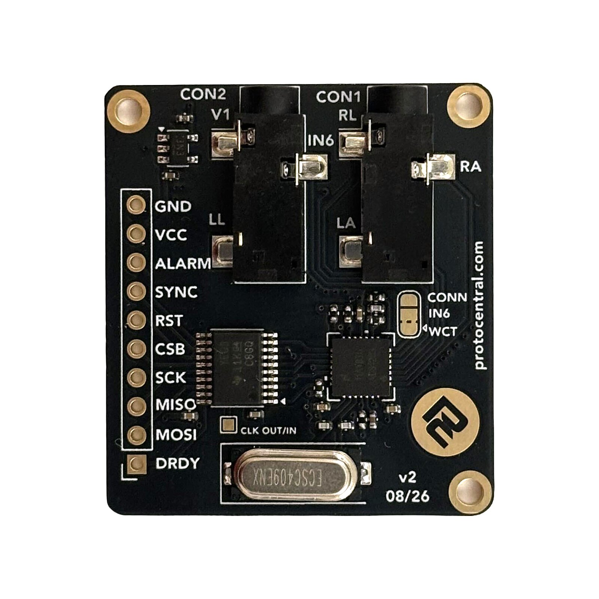
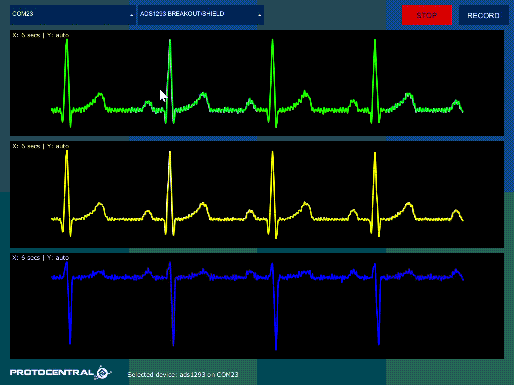

# ProtoCentral ADS1293 ECG Arduino Library

[](https://github.com/Protocentral/protocentral-ads1293-arduino/actions/workflows/arduino-lint.yml)
[](https://github.com/Protocentral/protocentral-ads1293-arduino/actions/workflows/compile-examples.yml)

Arduino library for the **ProtoCentral ADS1293 Breakout**: 3-lead and 5-lead ECG from the TI ADS1293 three-channel 24-bit analog front end. It exposes every feature of the chip, from lead-off detection and pace channels to the Wilson terminal and battery monitor, and runs on an Arduino Uno.

## Don't have one? [Buy it here](https://protocentral.com/product/protocentral-ads1293-breakout-board/)



## Links

| | |
|---|---|
| 🛒 Product page | https://protocentral.com/product/protocentral-ads1293-breakout-board/ |
| 📖 Getting started guide | https://docs.protocentral.com/getting-started-with-ADS1293/ |
| 🔧 Hardware design files | [hardware/v2](hardware/v2/) (KiCad) and [hardware/v1](hardware/v1/) (Eagle) in this repository |
| 📈 OpenView companion app | https://github.com/Protocentral/protocentral_openview |
| 📄 ADS1293 datasheet (TI SNAS602C) | https://www.ti.com/lit/ds/symlink/ads1293.pdf |

## How it works

The ADS1293 has three identical measurement channels. Each one has an instrumentation amplifier (fixed gain 3.5), a sigma-delta modulator and a three-stage digital filter. A flexible switch matrix connects any of the six inputs (IN1–IN6) to any channel. The chip also contains the ECG-specific blocks: right-leg drive, a common-mode detector, lead-off detection, a Wilson central terminal and a battery monitor.

The breakout wires the electrodes like this, and the library's lead sets use that wiring:

| Channel | 3-lead | 5-lead |
|---|---|---|
| **CH1** | Lead I = LA − RA | Lead I = LA − RA |
| **CH2** | Lead II = LL − RA | Lead II = LL − RA |
| **CH3** | off | V1 − WCT (Wilson central terminal, built on-chip from RA, LA and LL) |

The right-leg drive holds the body at mid-supply through the RL electrode and cancels common-mode noise. Lead III and the augmented leads follow from Lead I and Lead II: III = II − I, aVR = −(I + II)/2, aVL = I − II/2, aVF = II − I/2.

**The digital filter** has three decimation stages: R1, R2 and R3.
- **Pace data:** after the second stage, the chip outputs 16-bit pace data at a high rate (up to 25.6 kSPS). This is the input for pacemaker-pulse detection.
- **ECG data:** after the third stage, it outputs 24-bit ECG at 25–1600 SPS, or up to 6.4 kSPS with the fast modulator clock.
- **Rate formula:** ECG rate = f<sub>MOD</sub> / (R1 × R2 × R3), with f<sub>MOD</sub> = 102.4 kHz.

Each read returns, in one SPI transaction:
- the data-status byte;
- every enabled ECG and pace value;
- when an alarm is active, also the lead-off flags and the error flags.

## Features

- **ECG**
  - 3-lead (Lead I, Lead II) and 5-lead (adds V1 against the Wilson central terminal)
  - Any input-to-channel routing for custom setups
  - 15 data-rate presets from 25 to 1600 SPS, plus direct control of R1/R2/R3, per-channel rates and the 204.8 kHz modulator clock
  - High-resolution INA mode, ECG filter bypass
  - Readings converted to µV at the electrodes
- **Lead-off detection** in all three modes the chip offers: DC, analog AC (works with dry electrodes) and digital AC (electrode impedance through the signal path). Flags are reported per electrode with every sample during an alarm
- **Pace**
  - 16-bit digital pace data per channel at up to 25.6 kSPS, with double pace-rate mode
  - Separate analog pace channel with WCT / RLDIN output
- **Patient reference circuits**
  - Right-leg drive and common-mode detector, both with bandwidth and capacitive-drive settings
  - Wilson central terminal and Goldberger terminals
- **Self-test and monitoring**
  - Positive, negative and zero (shorted-input) test signals on any channel
  - **Supply voltage** via the battery monitor
  - Every error register: common-mode and RLD range, low supply, INA and modulator over-range, synchronization
  - Alarm mask and alarm filter
- **Clock:** on-board crystal or external 409.6 kHz clock; clock output for **multi-board sync**
- **Data-ready handling:** polled with the DRDY pin, **interrupt-driven** with a missed-sample counter, or **without DRDY** by polling the chip's status register
- **Robust bring-up**
  - Every register write is verified by read-back
  - The chip is reset to a known state even after an MCU-only reset
  - `begin()` reports `NoClock` when the chip answers but makes no conversions
- **Shared-bus safe:** SPI transactions on any `SPIClass`. Settings can be changed while streaming
- **Standalone:** `depends=` is empty, so there is nothing else to install
- **Host boards:** Uno, Nano, Mega, Leonardo, Uno R4, Nano 33 BLE, nRF52840, ESP32, ESP32-S3, ESP32-C3 and RP2040

## Safety

> **Not a medical device. For research and education only.**
>
> The breakout has **no patient isolation**. When electrodes are on a person, power the host from a **battery**. Never connect electrodes while the host is plugged into mains-powered USB or test equipment.

## Installation

### Arduino Library Manager (Recommended)

1. Open **Sketch → Include Library → Manage Libraries…**
2. Search for **ProtoCentral ADS1293**.
3. Install **ProtoCentral ADS1293 ECG Library**.

### Manual Installation

Download this repository as a ZIP, then use **Sketch → Include Library → Add .ZIP Library…**

## Hardware Setup

### Header pins (v2 board)

| Pin | Name | Function | Notes |
|---|---|---|---|
| 1 | DRDY | Data ready, active low | Optional: pass `-1` to poll the chip instead |
| 2 | MOSI | SPI data in | SPI mode 0 |
| 3 | MISO | SPI data out | |
| 4 | SCK | SPI clock | |
| 5 | CSB | SPI chip select | |
| 6 | RST | RSTB reset, active low | **Connect it** (see below) |
| 7 | SYNC | SYNCB filter synchronization | **Connect it** (see below) |
| 8 | ALARM | ALARMB, open drain, active low | Optional: the library reads the error registers instead |
| 9 | VCC | Power in, 3.3–5 V | Feeds the on-board 3.3 V regulator. **Also sets the logic level of pins 1–8** |
| 10 | GND | Ground | |

Pins 1–8 go through a TXB0108 auto-direction level shifter, whose MCU side runs at VCC. Power the board from the same voltage as your MCU's I/O: 5 V for an Uno, 3.3 V for ESP32, nRF52 and RP2040. Do not put pull-up or pull-down resistors on these lines; the library sets DRDY as a plain input.

**RST and SYNC must be driven.** The chip's own 1 MΩ pull-ups on these lines sit on the chip side of the level shifter, so the header pins have no defined level of their own. An RST or SYNC pin that is left unconnected, or wired to an MCU pin the sketch never configures, can hold the chip in reset or keep restarting its filters. The symptom is `NoClock`, or data that comes and goes between resets. Either:
- wire both to MCU pins and pass them to the constructor: `Protocentral_ADS1293 ads(CS, DRDY, RST, SYNC);`. The library holds them HIGH. **(Recommended.)**
- or tie both to VCC and pass `-1`.

If SYNC is not passed to the library, the library makes the chip drive SYNCB itself, so an unconnected SYNC pin is harmless. RST has no such fallback.

**CLK** (409.6 kHz, for an external clock or multi-board sync) is on the **CLK OUT/IN** pad next to the level shifter, not the header. It is not level-shifted: 3.3 V signals only.

### Wiring

| Breakout | Arduino Uno / Nano / R4 | ESP32 DevKit | ESP32-S3 DevKitC | ESP32-C3 | Others |
|---|---|---|---|---|---|
| CSB  | D4  | GPIO5 (SS) | GPIO10 (SS) | GPIO7 (SS) | any pin |
| DRDY | D2  | GPIO4      | GPIO4       | GPIO3      | any pin (interrupt-capable for example 06) |
| RST  | D5  | GPIO25     | GPIO5       | GPIO1      | any pin |
| SYNC | D6  | GPIO26     | GPIO6       | GPIO10     | any pin |
| SCK  | D13 | GPIO18     | GPIO12      | GPIO4      | board SPI SCK |
| MISO | D12 | GPIO19     | GPIO13      | GPIO5      | board SPI MISO |
| MOSI | D11 | GPIO23     | GPIO11      | GPIO6      | board SPI MOSI |
| VCC  | 5V  | 3V3        | 3V3         | 3V3        | MCU I/O voltage |
| GND  | GND | GND        | GND         | GND        | |

**Pin notes**
- **Default SPI pins:** the examples use each board's own SPI pins (`SPI.begin()`), so only CS, DRDY, RST and SYNC are chosen in the sketch.
- **Custom pins:** on ESP32, pass your own SPI pins with `ads.begin(sck, miso, mosi)`.
- **ESP32-S2 / S3 / C3:** the classic ESP32 VSPI pins 18/19/23 are the USB pins on these chips, or do not exist.
- **Uno interrupts:** DRDY on D2 is interrupt-capable, which example 06 needs.

### Hardware revisions

| | v2 (current) | v1 |
|---|---|---|
| Header | 10-pin: DRDY, MOSI, MISO, SCK, CSB, RST, SYNC, ALARM, VCC, GND | 12-pin: 5V, GND, ALARM, RST, OE, CS, MOSI, SCK, MISO, DRDY, CLK, GND |
| SYNC | On the header | Not brought out (1 MΩ pull-up on the chip). Pass `-1` |
| CLK | CLK OUT/IN pad | Header pin |
| Logic level | Equal to VCC | Set by solder jumper SJ1 (VIN or 3.3 V) |
| IN6 jumper | JP2 | JMP1 |

The same library and examples run on both revisions.

### Electrode placement

The board has two 3.5 mm jacks, CON1 and CON2. Use fresh gel electrodes on clean, dry skin.

| Electrode | Placement | Jack | Contact | Input |
|---|---|---|---|---|
| **RA** | Right arm, or below the right collarbone | CON1 | Ring | IN1 |
| **LA** | Left arm, or below the left collarbone | CON1 | Tip | IN2 |
| **RL** | Right leg, or lower right abdomen | CON1 | Sleeve | IN4 (right-leg drive) |
| **LL** | Left leg, or lower left abdomen | CON2 | Tip | IN3 |
| **V1** | 4th intercostal space, right of the sternum | CON2 | Sleeve | IN5 (5-lead only) |

**Solder jumper CONN IN6 / WCT** (JP2; JMP1 on v1) connects IN6 either to the ring of CON2 or to the WCT pin. The 5-lead profile drives IN6 from the on-chip Wilson terminal, so make sure nothing is plugged into the ring of CON2.

## Quick Start

```cpp
#include <SPI.h>
#include "Protocentral_ADS1293.h"

Protocentral_ADS1293 ads(4 /*CS*/, 2 /*DRDY*/, 5 /*RST*/, 6 /*SYNC*/);

void setup() {
    Serial.begin(115200);
    if (!ads.begin()) {                        // 3-lead ECG at 200 SPS
        Serial.println((int)ads.lastError());  // see ADS1293_Status
        while (1);
    }
}

void loop() {
    ADS1293_Sample s;
    if (ads.available() && ads.read(s)) {
        Serial.print(ads.countsToMicrovolts(s.ecg[0]));  // Lead I, µV
        Serial.print(' ');
        Serial.println(ads.countsToMicrovolts(s.ecg[1], ADS1293_Channel::CH2));  // Lead II
    }
}
```

### Custom configuration

`begin()` with no arguments applies the 3-lead profile:
- CH1 = Lead I, CH2 = Lead II, CH3 off
- 200 SPS, from the on-board crystal
- right-leg drive on RL
- common-mode detection on RA, LA and LL
- DC lead-off detection on RA, LA and LL at 32 nA

To change it, pass an `ADS1293_Config`:

```cpp
ADS1293_Config cfg;
cfg.leadSet        = ADS1293_LeadSet::FiveLead;   // ThreeLead, FiveLead or Custom
cfg.dataRate       = ADS1293_DataRate::SPS_400;
cfg.highResolution = true;
cfg.leadOff        = false;
ads.begin(cfg);
```

| Field | Default | Meaning |
|---|---|---|
| `leadSet` | `ThreeLead` | Electrode set. `Custom` routes nothing: use `setChannelInputs()` and `setChannelEnabled()` |
| `dataRate` | `SPS_200` | ECG rate, all channels |
| `clock` | `Crystal` | `Crystal` (on-board 4.096 MHz) or `External` (409.6 kHz on CLK) |
| `clockOutput` | `false` | Drive the clock out on CLK (multi-board master) |
| `sync` | `Auto` | SYNCB handling. `Auto`: the MCU holds SYNC HIGH, or the chip drives SYNCB itself if no SYNC pin is given. `Master` / `Slave`: multi-board sync (example 09) |
| `highResolution` | `false` | High-resolution INA mode on every channel |
| `rld` | `true` | Right-leg drive into RL (IN4) |
| `leadOff` / `leadOffCurrent` | `true` / `32` nA | DC lead-off on the lead set's electrodes |
| `testSignal` | `Off` | Replace the electrode inputs with a test signal |
| `autoStart` | `true` | Start conversions and verify the clock at the end of `begin()` |

Every setter in the API reference also works later, even while streaming. The driver stops conversions briefly for registers the chip locks while running.

### Using a different SPI bus or pins

```cpp
Protocentral_ADS1293 ads(CS, DRDY, RST, SYNC, SPI1);   // any SPIClass; any pin may be -1
ads.begin(sck, miso, mosi);                      // ESP32 only: custom SPI pins
```

## Data format and units

`read()` fills an `ADS1293_Sample`:

| Field | Meaning |
|---|---|
| `ecg[3]` | ECG counts per channel, **signed around mid-scale** (0 = 0 V differential) |
| `pace[3]` | Pace counts, signed around mid-scale (channels with pace read-back only) |
| `ecgUpdated` / `paceUpdated` | Bit *n* set: channel *n*+1 has a new conversion |
| `leadOff` | ERROR_LOD flags (`ADS1293_ELECTRODE_RA` …), read while an alarm is active |
| `errors` | ERROR_STATUS flags (`ADS1293_ERR_*`) latched since the previous alarm |

**Counts to microvolts:**
- The chip's output code is offset binary, with a full-scale code (ADCMAX) that depends on R2 and R3.
- `countsToMicrovolts(counts, channel)` uses the right ADCMAX for the channel's current settings: V = counts / ADCMAX × 2 × 2.4 V / 3.5.
- The input range is ±400 mV differential.

| Preset | R2 | R3 | ECG bandwidth | Typical noise |
|---|---|---|---|---|
| `SPS_25` … `SPS_100` | 8 / 5 / 4 | 128 / 64 | 5–20 Hz | 0.8–1.1 µV RMS |
| `SPS_160`, `SPS_200` | 5 / 4 | 32 | 32–40 Hz | 1.4–1.5 µV RMS |
| `SPS_320`, `SPS_400` | 5 / 4 | 16 | 65–80 Hz | 1.9–2.1 µV RMS |
| `SPS_640` … `SPS_1600` | 5 / 4 | 8 / 6 / 4 | 130–325 Hz | 2.6–4.5 µV RMS |

Noise figures are TI's low-power-mode values (datasheet Table 8). `highResolution` lowers them by 7–18 %.

## API Reference

### Constructor and lifecycle

| Method | Description |
|---|---|
| `Protocentral_ADS1293(cs, drdy = -1, reset = -1, sync = -1, SPIClass& spi = SPI)` | `-1` = pin not wired. RST and SYNC are driven by the library |
| `bool begin(bool startSPI = true)` | Drive RST/SYNC, reset, check REVID `0x01`, apply the 3-lead profile, start, verify conversions |
| `bool begin(const ADS1293_Config&, bool startSPI = true)` | Same, with a custom configuration |
| `bool begin(sck, miso, mosi, config)` | ESP32 only: custom SPI pins |
| `bool reset()` | Reset the chip (RSTB pulse if wired) and re-apply the last configuration |
| `void end()` | Release the interrupt and power the chip down |
| `ADS1293_Status lastError()` | `Ok`, `SpiError`, `WrongChipId`, `VerifyFailed`, `NoClock`, `Timeout`, `NotInterruptPin`, ... |
| `bool isConnected()` / `uint8_t readID()` | Presence check / REVID register |
| `getLibraryVersion()` | Library version string |

### Reading data

| Method | Description |
|---|---|
| `bool available()` | New data is waiting |
| `bool read(ADS1293_Sample&)` | Read it (see Data format) |
| `enableDataReadyInterrupt()` / `disableDataReadyInterrupt()` | Latch DRDY with an interrupt instead of polling |
| `uint32_t missedSamples()` | Data-ready events overwritten before being read (interrupt mode) |
| `setEcgReadback(ch, bool)` / `setPaceReadback(ch, bool)` | Choose what each read returns |
| `setDataReadySource(ADS1293_DataSource)` | Override the DRDY source (`None` = automatic, fastest source) |
| `setDataReadyMasking(atStart, afterSyncError)` | DRDY masking after start / after a sync error |

### Conversion, power and data rate

| Method | Description |
|---|---|
| `start()` / `stop()` / `standby()` / `powerDown()` / `wakeup()` / `isRunning()` | Conversion and power control |
| `setDataRate(ADS1293_DataRate)` | `SPS_25` … `SPS_1600` presets |
| `setR2(ADS1293_R2)` / `setR3(ch, ADS1293_R3)` | Direct decimation control; channels may run at different rates |
| `setDoublePaceRate(ch, bool)` | R1 = 2: doubles the channel's pace and ECG rate |
| `setHighSampleClock(ch, bool)` | 204.8 kHz modulator: doubles the channel's rates, lowers noise |
| `setEcgFilterBypass(ch, bool)` | Skip the third filter stage |
| `float getSampleRate(ch)` / `getPaceRate(ch)` | Current ECG / pace rate in samples per second |

### Channels

| Method | Description |
|---|---|
| `setChannelInputs(ch, positive, negative)` | Route any of `IN1`…`IN6` to a channel |
| `setChannelEnabled(ch, bool)` / `isChannelEnabled(ch)` | Power a channel up or down |
| `setTestSignal(ch, sig)` / `setTestSignal(sig)` | `Positive`, `Negative` (±200 mV), `Zero` (shorted), `Off` |
| `setHighResolution(ch, bool)` | High-resolution INA mode |
| `setFaultDetection(ch, bool)` | INA output near-rail detection |

Channels are `ADS1293_Channel::CH1` / `CH2` / `CH3`. Inputs are `ADS1293_Input::IN1` … `IN6`.

### Lead-off detection

| Method | Description |
|---|---|
| `configureLeadOffDC(inputs, nA = 32)` | DC current into each pin (0–2040 nA, 8 nA steps) |
| `configureLeadOffAnalogAC(inputs, nA, Hz, level)` | AC excitation (~6 Hz – 12.5 kHz), comparator level 1–4. Works with dry electrodes |
| `configureLeadOffDigitalAC(channels, nA, Hz, antiPhase)` | Balanced AC current per channel; measure the tone in the ECG data |
| `disableLeadOff()` | Off |
| `uint8_t readLeadOffStatus()` | ERROR_LOD: `ADS1293_ELECTRODE_RA` / `LA` / `LL` / `RL` / `V1` bits |

`inputs` is a mask of `ADS1293_IN1` … `ADS1293_IN6` (or the `ADS1293_ELECTRODE_*` names). Every mode needs the RL electrode as the current return.

### Common mode, right-leg drive and reference terminals

| Method | Description |
|---|---|
| `configureCommonModeDetect(inputs, highBandwidth, capDrive)` | Pins averaged by the common-mode detector |
| `configureRLD(enable, output = IN4, highBandwidth, capDrive)` | Right-leg drive amplifier |
| `configureWilson(a, b, c, connectToIN6 = true)` | Wilson central terminal from three pins |
| `configureGoldberger(a, b, c)` | Goldberger terminals onto IN4–IN6 (see Board limitations) |
| `setReference(internal, commonMode = true)` | Internal 2.4 V and CM/RLD references |

### Pace, clock and synchronization

| Method | Description |
|---|---|
| `configureAnalogPace(enable, pos, neg, output)` | Fourth (analog) INA, output to `Wct` or `RldIn` |
| `setClockOutput(bool)` | Drive the 409.6 kHz clock out on CLK |
| `setSyncMode(ADS1293_SyncMode)` / `getSyncMode()` | `Auto`, `Master` or `Slave` SYNCB handling |
| `configureSync(output, source)` | Manual SYNCB setting (overrides the sync mode) |
| `setDriveStrength(ADS1293_DriveStrength)` | SDO drive strength |

### Errors, alarms and measurements

| Method | Description |
|---|---|
| `uint8_t readErrorStatus()` | ERROR_STATUS (`ADS1293_ERR_*`). Clears the latched flags and releases ALARMB |
| `uint8_t readRangeErrors(ch)` | ERROR_RANGEx (`ADS1293_RANGE_*`): INA near rail, differential over-range, modulator over-range |
| `uint8_t readSyncErrors()` / `readMiscErrors()` | ERROR_SYNC / live CMOR, RLDRAIL, BATLOW |
| `setAlarmMask(mask)` / `setAlarmFilter(lodCounts, otherCounts)` | Which errors pull ALARMB low / how long they must persist |
| `float readSupplyVoltage(ch = CH3)` | Chip supply via the battery monitor. Briefly borrows a channel |
| `float countsToMicrovolts(counts, ch)` / `paceCountsToMicrovolts(counts)` | Units |
| `uint32_t getAdcMax(ch)` | Full-scale code for the channel's current filter settings |
| `readRegister(reg)` / `writeRegister(reg, value)` / `printRegisters(Stream&)` | Raw register access (writes verified) |

### Constants

| Constant | Meaning |
|---|---|
| `ADS1293_ELECTRODE_RA` / `LA` / `LL` / `RL` / `V1` | Lead-off and input bits by electrode (breakout wiring) |
| `ADS1293_IN1` … `ADS1293_IN6` | The same bits by chip input |
| `ADS1293_ERR_*`, `ADS1293_RANGE_*`, `ADS1293_SYNC_*`, `ADS1293_MISC_*` | Error register bits |
| `ADS1293_REG_*` | Register addresses, for `readRegister()` / `writeRegister()` |
| `ADS1293_SPI_CLOCK` | SPI clock, default 1 MHz. Define before the include to override |

## Examples

| # | Sketch | Description |
|---|---|---|
| 01 | `01.ThreeLeadSerialPlotter` | Leads I, II and III in µV in the Arduino Serial Plotter |
| 02 | `02.FiveLeadSerialPlotter` | Leads I, II and V1 (Wilson central terminal) |
| 03 | `03.OpenView` | Stream three leads to OpenView |
| 04 | `04.LeadOffDetection` | Report which electrode is off, DC or analog AC mode |
| 05 | `05.SelfTest` | Test signals and noise floor on all channels, no electrodes needed |
| 06 | `06.InterruptDriven` | 400 SPS with an interrupt on DRDY and a missed-sample counter |
| 07 | `07.PaceDetection` | 3.2 kSPS pace data and a simple pacemaker-pulse detector |
| 08 | `08.SupplyAndAlarms` | Supply voltage and every error register, decoded |
| 09 | `09.MultiBoardClockSync` | Two boards sharing clock and SYNCB: six ECG channels sampled in step |
| 10 | `10.Diagnostics` | Version, REVID, register dump, clock, data-path, DRDY and signal-chain checks. **Run this first if something is wrong** |

All examples print at **115200 baud**.

## Streaming to OpenView

1. Upload `03.OpenView`.
2. Open [ProtoCentral OpenView](https://github.com/Protocentral/protocentral_openview).
3. Select the **ADS1293 Breakout** board, then pick the serial port.



The sketch sends 200 packets per second at 115200 baud. Each packet has:
- the header `0x0A 0xFA 0x0C 0x00 0x02`;
- a 12-byte payload of three little-endian `int32` values: Lead I, Lead II, and Lead III (or V1 in 5-lead mode);
- the footer `0x00 0x0B`.

This layout is shared with OpenView's `ads1293` board descriptor. The sketch prints nothing else, because any text would corrupt the stream.

## Board limitations

Some ADS1293 features are limited by how the breakout is wired:

| Feature | On this board |
|---|---|
| **SYNCB (v1 only)** | Not on the v1 header. Multi-board setups share the clock, but their filters are not phase-aligned |
| **Goldberger terminals** | The chip connects them to IN4–IN6, and IN4 is the RL electrode. Disable the RLD before using them, or derive the augmented leads in software (see How it works) |
| **Analog pace output to RLDIN** | RLDIN is tied to RLDREF on the board. Use the `Wct` output (WCT pin, via JP2 / JMP1) instead |
| **CLK** | CLK OUT/IN pad on v2. Not level-shifted: 3.3 V signals only |

## Troubleshooting

**`begin()` fails with `SpiError`**
- Check the CS/SCK/MOSI/MISO wiring, VCC and GND.
- On ESP32-S2/S3/C3, do not use pins 18/19/23. Use the board's default SPI pins.

**`begin()` fails with `VerifyFailed`**
- Registers are not reading back correctly. Shorten the wires, or define `ADS1293_SPI_CLOCK 500000` before the include.

**`begin()` fails with `NoClock`, or data comes and goes between resets**
- The chip answers but makes no conversions.
- First check RST and SYNC: on v2 they must be wired to MCU pins passed to the constructor, or tied to VCC (see Header pins).
- Power-cycle the board (not only the MCU) and run `10.Diagnostics`.
- Check that the crystal runs: the CLK OUT/IN pad reads about 1.65 V DC while the clock output is on.
- Make sure nothing drives CLK.

**No samples, or DRDY looks stuck (low, or at an intermediate voltage)**
- Run `10.Diagnostics`. It checks the data path and the DRDY pin separately.
- Remove any pull-up or pull-down from DRDY (the TXB0108 cannot drive them). Check that VCC matches your MCU's I/O voltage (SJ1 on v1).
- If DRDY is faulty but the data path is OK, pass `-1` as the DRDY pin. The library then polls the chip.

**All electrodes report lead-off**
- The RL electrode is missing or loose: the lead-off current has no return path.

**`ERROR_LOD` stays 0 with no electrodes**
- Lead-off detection is off. Enable it in the config, or with `configureLeadOffDC()`.

**Flat or noisy ECG**
- Run `05.SelfTest` first. If the board passes, the problem is electrode contact or placement.
- Use fresh electrodes, keep cables still, and run on battery power.

**Mains hum (50/60 Hz)**
- Move away from mains cables and chargers, and power from a battery.
- The RL electrode must be attached.

## Migrating from 1.x

Version 2.0 is a ground-up rewrite, and the 1.x API has been removed.

| 1.x | 2.0 |
|---|---|
| `#include "protocentral_ads1293.h"` | `#include "Protocentral_ADS1293.h"` |
| `ads1293 ADS1293(DRDY, CS);` | `Protocentral_ADS1293 ads(CS, DRDY, RST, SYNC);` (note the order) |
| `ADS1293.begin()` / `begin(sck, miso, mosi)` + ten `configure…()` calls | `ads.begin()` or `ads.begin(cfg)`, which returns `bool` |
| `configureChannel3(...)` + `configureWilsonCentralTerminal()` | `cfg.leadSet = ADS1293_LeadSet::FiveLead` |
| `setSamplingRate(SamplingRate::SPS_128)` (actually 320 SPS) | `setDataRate(ADS1293_DataRate::SPS_320)` (names are the real rates) |
| `isDataReady()` + `getECGData()` | `if (ads.available() && ads.read(s))` |
| `samples.ch1` / `ch2` / `ch3` | `s.ecg[0]` / `s.ecg[1]` / `s.ecg[2]` |
| `rawToVoltage(code)` | `ads.countsToMicrovolts(counts, channel)` |
| `attachTestSignal(ch, TestSignal::Positive)` | `ads.setTestSignal(channel, ADS1293_TestSignal::Positive)` |
| `readErrorStatus()` | `ads.readErrorStatus()` (same) |

**Outputs that change in 2.0:**
- **ECG values** are now centred on 0 for 0 V input, and they no longer jump sign at large positive inputs.
- **OpenView** runs at 115200 baud and 200 SPS.

See [CHANGELOG.md](CHANGELOG.md) for details.

## Related

| | |
|---|---|
| Hardware design files | [hardware/v2](hardware/v2/), [hardware/v1](hardware/v1/) |
| OpenView companion app | https://github.com/Protocentral/protocentral_openview |
| TI ADS1293 datasheet (SNAS602C) | https://www.ti.com/lit/ds/symlink/ads1293.pdf |

## License

- **Software:** MIT
- **Hardware and documentation:** CC BY-SA 4.0

See [LICENSE.md](LICENSE.md).

Copyright (c) 2019-2026 ProtoCentral Electronics.

## Support

Open an issue on [GitHub](https://github.com/Protocentral/protocentral-ads1293-arduino/issues) or email support@protocentral.com.
